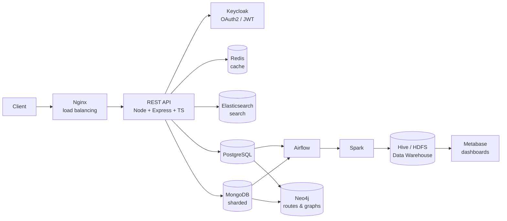
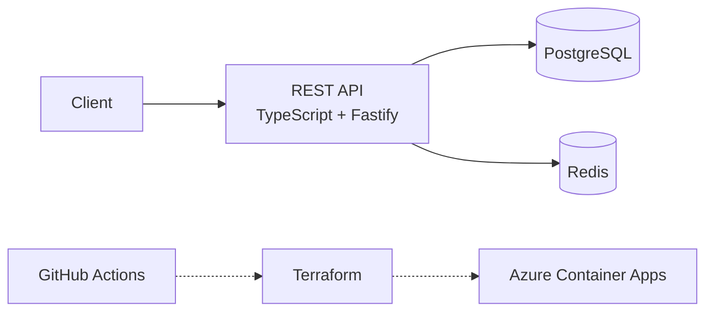
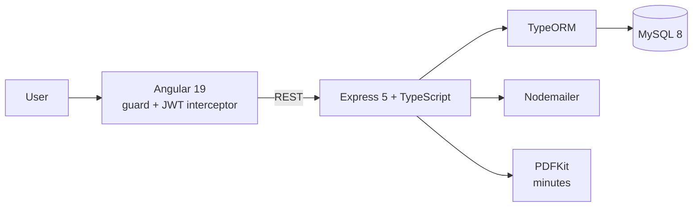

# Sebastián Rodríguez

Computer Engineering student at the Costa Rica Institute of Technology (TEC). I like understanding how the pieces of a system fit together: from the API and the database to deployment and the interface.

Right now: building a cloud-native platform on **Azure + Terraform** and learning **Angular + TypeScript** on the frontend.

📍 San José, Costa Rica · ✉️ seb08rs@gmail.com · [LinkedIn](https://www.linkedin.com/in/sebastián-rodríguez-sánchez)

  

---

## 1. Smart Restaurant Reservations

*(repo: Reserva Inteligente de Restaurantes)*

Distributed platform for restaurants, reservations and orders, with a transactional layer (OLTP) and an analytical layer (OLAP) on the same data.

- **Swappable database engine:** `DB_TYPE=postgres` or `mongodb` and the system switches engines with no code changes, thanks to a repository abstraction built around a `RepositoryFactory`.
- **High availability:** MongoDB with sharding (config servers, routers, replica sets) and automatic initialization.
- **Analytics pipeline:** ETL orchestrated with Airflow, processed with Spark, star schema in Hive on HDFS (Parquet), dashboards in Metabase.
- **Deployment:** Docker Compose profiles, plus Kubernetes manifests.
- **API documented** with Swagger.

**Stack:** TypeScript · Node.js · Express · PostgreSQL · MongoDB · Redis · Elasticsearch · Keycloak · Docker · Kubernetes · Nginx · Airflow · Spark · Hive · Neo4j · Metabase

  

---

## 2. Sports Analytics Platform · *in development*

Cloud-native sports analytics platform, designed from day one to be deployed as infrastructure as code.

Dotted lines show what comes next (CI/CD and deployment on Azure).

- **Done (phases 1–3):** project structure, Fastify API, PostgreSQL and Redis with Docker Compose, versioned SQL migrations, health checks and tests.
- **Next:** infrastructure with Terraform, a GitHub Actions pipeline and deployment to Azure Container Apps.
- The architecture is documented in `docs/architecture.md`.

**Stack:** TypeScript · Fastify · PostgreSQL · Redis · Docker · Terraform · GitHub Actions · Azure Container Apps

  

---

## 3. Board Meeting Management System

*(repo: Juntas-directivas)*

Full-stack application covering the whole lifecycle of a board meeting: email invitations, agenda, attendance, live decisions and tasks, and the final minutes as a PDF. Team project.

- **Three agenda item types** (informative, strategic and approval) created with a Factory pattern and stored in a single table using table inheritance.
- **Queries built with the Visitor pattern:** meetings a member missed, and minutes by presenter or by task owner.
- **Adapter** to treat a board member as a regular system user.
- **Notifications**, tasks with owners, voting and file attachments per agenda item.

**Stack:** Angular 19 · Angular Material · TypeScript · Express · TypeORM · MySQL · JWT · Docker

  

---

## 4. AP-LABS · TEC lab management

**Kotlin** application (Gradle project) to manage the laboratories at TEC. I later rebuilt it as a TypeScript web application ([AP-LABS2](https://github.com/sebro08/AP-LABS2)) to compare both approaches.

**Stack:** Kotlin · Gradle

  

---

## Technologies

**Languages**  
     

**Frontend**  
 

**Backend & authentication**  
   

**Databases & search**  
      

**Data & analytics**  
 

**Infrastructure & deployment**  
    

**Design & organization**  
  

---

## What I've used and where

| Technology | Where I used it |
|---|---|
| TypeScript, Node.js, Express | Smart Restaurant Reservations, Sports Analytics Platform, Board Meeting Management, AP-LABS2 |
| MySQL, TypeORM | Board Meeting Management |
| PostgreSQL, MongoDB (sharding) | Smart Restaurant Reservations (swappable); PostgreSQL in the Sports Analytics Platform |
| Redis, Elasticsearch | Caching and search |
| Keycloak (OAuth2 / JWT) | Authentication and roles in Smart Restaurant Reservations |
| JWT, bcrypt | Authentication in Board Meeting Management |
| Docker, Kubernetes, Nginx | Deployment and load balancing |
| GitHub Actions, Azure | Sports Analytics Platform |
| Airflow, Spark, Neo4j | Analytics pipeline in Smart Restaurant Reservations |
| Kotlin | AP-LABS |
| Java, JFlex, CUP | [Compilers and interpreters](https://github.com/sebro08/CompiladoresJFlex) |
| C++, Python, MySQL, Oracle | University coursework |
| Figma, Canva | Design and prototyping |

---

Feedback on a repo, or interested in collaborating? Open an issue or get in touch.