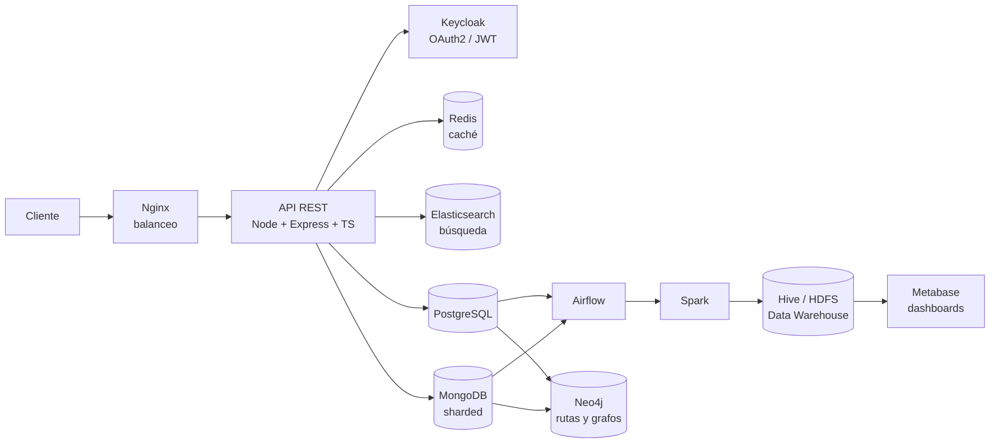
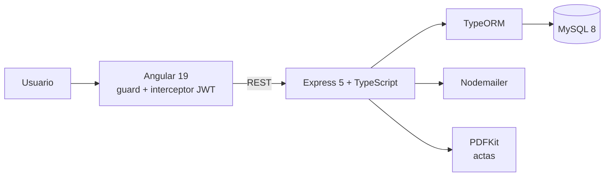

# Sebastián Rodríguez

Estudiante de Ingeniería en Computación en el TEC, Costa Rica. Me interesa entender cómo encajan las piezas de un sistema: de la API y la base de datos hasta el despliegue y la interfaz.

Ahora mismo: construyendo una plataforma cloud-native en **Azure + Terraform** y aprendiendo **Angular + TypeScript** en el frontend.

📍 San José, Costa Rica · ✉️ seb08rs@gmail.com · [LinkedIn](https://www.linkedin.com/in/sebastián-rodríguez-sánchez)

  

---

## 1. Reserva Inteligente de Restaurantes

Plataforma distribuida para restaurantes, reservas y pedidos, con una capa transaccional (OLTP) y otra analítica (OLAP) sobre los mismos datos.

- **Motor de base de datos intercambiable:** `DB_TYPE=postgres` o `mongodb` y el sistema cambia de motor sin tocar código, gracias a una abstracción de repositorios con `RepositoryFactory`.
- **Alta disponibilidad:** MongoDB con sharding (config servers, routers, replica sets) con inicialización automática.
- **Pipeline analítico:** ETL orquestado con Airflow, procesado con Spark, esquema estrella en Hive sobre HDFS (Parquet), dashboards en Metabase.
- **Despliegue:** Docker Compose por perfiles, y manifiestos de Kubernetes.
- **API documentada** con Swagger.

**Stack:** TypeScript · Node.js · Express · PostgreSQL · MongoDB · Redis · Elasticsearch · Keycloak · Docker · Kubernetes · Nginx · Airflow · Spark · Hive · Neo4j · Metabase

[Ver repositorio →](https://github.com/sebro08/Reserva-Inteligente-de-Restaurantes)

---

## 2. Plataforma de análisis deportivo · *en desarrollo*

Plataforma cloud-native de análisis deportivo, pensada desde el inicio para desplegarse como infraestructura como código.

Las líneas punteadas son la parte que viene (CI/CD y despliegue en Azure).

- **Hecho (fases 1–3):** estructura del proyecto, API con Fastify, PostgreSQL y Redis con Docker Compose, migraciones SQL versionadas, health checks y tests.
- **Siguiente:** infraestructura con Terraform, pipeline en GitHub Actions y despliegue en Azure Container Apps.
- La arquitectura está documentada en `docs/architecture.md`.

**Stack:** TypeScript · Fastify · PostgreSQL · Redis · Docker · Terraform · GitHub Actions · Azure Container Apps

[Ver repositorio →](https://github.com/sebro08/NOMBRE-DEL-REPO)

---

## 3. Sistema de Administración de Juntas Directivas

Aplicación full-stack para el ciclo completo de una sesión de junta: convocatoria por correo, agenda, asistencia, decisiones y tareas en vivo, y acta final en PDF. Proyecto de equipo.

- **Tres tipos de punto de agenda** (informativo, estratégico y de aprobación) creados con un patrón Factory y guardados en una sola tabla con herencia.
- **Consultas con patrón Visitor:** sesiones en las que un miembro estuvo ausente, actas por expositor o por responsable.
- **Adapter** para tratar a un miembro de junta como usuario del sistema.
- **Notificaciones**, tareas con responsable, votaciones y archivos adjuntos por punto.

**Stack:** Angular 19 · Angular Material · TypeScript · Express · TypeORM · MySQL · JWT · Docker

[Ver repositorio →](https://github.com/sebro08/admin-proyecto-g2)

---

## 4. AP-LABS · gestión de laboratorios del TEC

Aplicación en **Kotlin** (proyecto Gradle) para gestionar los laboratorios del TEC. Después la rehice como aplicación web en TypeScript ([AP-LABS2](https://github.com/sebro08/AP-LABS2)) para comparar ambos enfoques.

**Stack:** Kotlin · Gradle

[Ver repositorio →](https://github.com/sebro08/AP-LABS)

---

## Tecnologías

**Lenguajes**  
      

**Frontend y móvil**  
  

**Backend y autenticación**  
    

**Bases de datos y búsqueda**  
      

**Datos y analítica**  
   

**Infraestructura y despliegue**  
     

**Diseño y organización**  
  

---

## Qué he usado y dónde

| Tecnología | Dónde la usé |
|---|---|
| TypeScript, Node.js, Express, Fastify | Reserva Inteligente, plataforma deportiva, Juntas Directivas, AP-LABS2 |
| MySQL, TypeORM | Juntas Directivas |
| PostgreSQL, MongoDB (sharding) | Reserva Inteligente (intercambiables); PostgreSQL en la plataforma deportiva |
| Redis, Elasticsearch | Caché y búsqueda |
| Keycloak (OAuth2 / JWT) | Autenticación y roles en Reserva Inteligente |
| JWT, bcrypt | Autenticación en Juntas Directivas |
| Docker, Kubernetes, Nginx | Despliegue y balanceo de carga |
| Terraform, GitHub Actions, Azure | Plataforma deportiva |
| Airflow, Spark, Hive, Neo4j, Metabase | Pipeline analítico de Reserva Inteligente |
| Kotlin | AP-LABS |
| Java, JFlex, CUP | [Compiladores e intérpretes](https://github.com/sebro08/CompiladoresJFlex) |
| C++, Python, MySQL, Oracle | Cursos de la carrera |
| Figma, Canva | Diseño y prototipos |

---

¿Feedback sobre algún repo o ganas de colaborar? Abre un issue o escríbeme.
